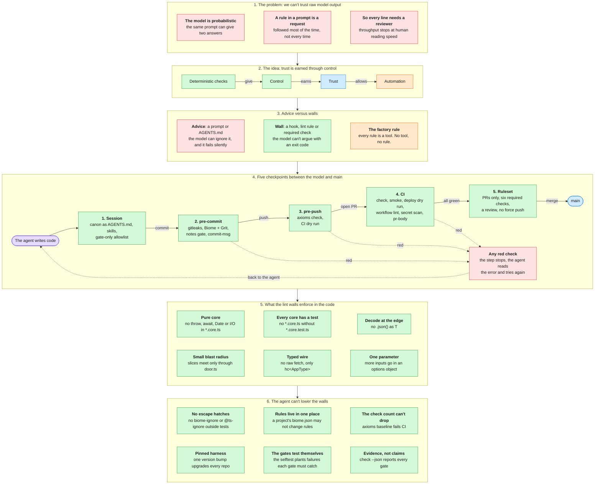

# factory

A harness, a CLI (`axioms`) and an app template for TypeScript apps that coding agents build. The
harness is a set of lint rules, git hooks, CI jobs and agent instructions. Projects install it as
a pinned dependency, so a rule fixed here reaches every project with a version bump.

## Why it exists

An agent can only build unattended if we trust its output, and we only trust what we control.
The factory controls the model with deterministic checks: a program, not a prompt, passes or fails
every change, with the same verdict on every run.



Red marks the risk, green a deterministic check, purple the model, blue what we trust, and orange
what control unlocks. We don't trust the model. We trust the checks around it.

## Quick start

You need [bun](https://bun.sh) 1.3.6 or later and git. The workflow linters and the secret
scanner come from `brew install actionlint zizmor gitleaks`.

```bash
git clone https://github.com/Pierre-Mike/factory.git
bun factory/cli/main.ts new my-app   # stamp, pin v<version>, install, format, commit
cd my-app
bun run check       # every gate
bun run smoke       # the real worker over HTTP, then bad bodies sent to every write route
bun run slice x     # add a feature slice
bun run deploy:dry  # bundle the worker and apply migrations locally (no Cloudflare account)
bun run ci:dry      # replay ci.yml on a clean clone; pre-push runs it when CI/CD files change
```

A project pins the harness as `github:Pierre-Mike/factory#vX.Y.Z`. `new` pins the tag of the CLI's
own version, so run it from a checkout of a release tag. To try an unreleased checkout, pass
`--harness file:<path>` and set `AXIOMS_ALLOW_LOCAL_HARNESS=1`, as the selftest does.

To put a project on GitHub, push `main` first, then protect it:

```bash
gh repo create <owner>/my-app --source . --remote origin --push
bunx axioms rules --apply   # the branch ruleset, and auto-merge on
```

Every change reaches `main` through a PR that passes the six CI checks. No approval is required:
agents open PRs under your login, and GitHub never counts a PR author's own approval. You review
the PR, then merge it, or queue it with `gh pr merge --auto --squash` to merge once CI is green.

Every project's CI runs `check`, `smoke`, `deploy-dry-run`, `workflow-lint` (actionlint + zizmor),
`secret-scan` (gitleaks, also on every commit via the pre-commit hook) and `pr-body` (the PR body
fills every section of the PR template). On a CI runner each scanner is downloaded at an exact
version and refused unless the archive matches the SHA256 pinned in `cli/tools.core.ts`. Every
GitHub Action is pinned by commit SHA.

A separate `.github/workflows/deploy.yml` runs `bunx axioms deploy` on every push to `main`, in a
`production` environment, with `CLOUDFLARE_API_TOKEN` and `CLOUDFLARE_ACCOUNT_ID` from secrets.
`axioms new --deploy manual` (or `"axioms": { "deploy": "manual" }` in package.json) makes it run
only when started by hand. It is not in ci.yml because `axioms ci-dry-run` replays every ci.yml
job. Doctor fails when deploy.yml is missing, does not run `axioms deploy`, or lets that step be
skipped or fail, and warns when either secret is missing on GitHub.

`axioms baseline` counts the checks Biome, the tests and the notes gate report and compares them to
`gate-baseline.json`. A drop fails. After adding checks on purpose, run `axioms baseline --update`
and commit the file. The factory's own CI runs it as the `gate-baseline` job.

## What is in here

| Path | What it is |
|---|---|
| `harness/biome.rules.ts` | Source of the shared Biome config. `bun run build:biome` writes `biome.shared.json`. |
| `harness/grit/` | Grit plugins: no `throw`/`await` in cores, one parameter per declared function, no `.json() as T`. |
| `harness/canon.md` | The rules every agent loads. `axioms sync` copies them into a project's AGENTS.md. |
| `harness/notes.md` | The Agent Note rules. `axioms sync` copies them to a project's `.agents/notes/README.md`; `axioms notes` enforces them. |
| `harness/github.rules.json` | The default branch's GitHub ruleset. `axioms rules --apply` writes it to the repo via `gh api`; `axioms doctor` fails when the live rules or auto-merge drift. |
| `harness/skills/` | Agent skills. `axioms sync` copies the directory into a project's `.claude/skills/`; `axioms doctor` fails on drift. Ships `tdd`, `peer-review` and `pull-request`. |
| `harness/claude.settings.json` | Source of a project's `.claude/settings.json`: a Claude Code permission allowlist for the project's own gate commands, nothing broader. |
| `harness/lefthook.yml` | Git hooks: format and the notes gate on commit, conventional commit messages, `axioms check` on push. |
| `cli/` | The `axioms` command. Pure logic in `*.core.ts`, file and process work in `commands/`. |
| `template/` | The app: Hono + Effect on Cloudflare Workers, D1, Vite + React + TanStack served as assets. |
| `tests/rules.test.ts` | Lints fixtures through the shared config and checks each rule fires where it should. |
| `tests/selftest.ts` | `new`, `sync`, `check`, `slice`, `smoke`, the deploy dry run and the CI dry run on a throwaway project, plus a deliberately broken workflow the CI dry run must catch and a malformed Agent Note the notes gate must reject. |
| `tests/selftest-adopt.ts` | `adopt` on a throwaway plain git repository: refusals, live hooks, sync stability, the lite `check` and its evidence report, the PR body gate and the notes gate, with no wrangler anywhere. |

## How a project uses it

A project depends on `@pierre-mike/axioms`, pinned to a release tag (`github:Pierre-Mike/factory#v0.12.0`), and owns only its app code:

- `biome.json` extends `@pierre-mike/axioms/biome` and may not add rules (`axioms doctor` checks).
- `lefthook.yml` extends the harness hooks.
- `AGENTS.md` holds a copy of `harness/canon.md` between markers; `CLAUDE.md` is `@AGENTS.md`.
- `.agents/notes/` holds the project's decisions as Agent Notes, so one agent session can find
  what an earlier one decided. Its `README.md` is a copy of `harness/notes.md`.
- `.claude/settings.json` and `.claude/skills/` are copies of `harness/claude.settings.json` and
  `harness/skills/` (`axioms doctor` checks); personal settings go in `.claude/settings.local.json`.
- `tsconfig.base.json` extends `@pierre-mike/axioms/tsconfig`.

To roll out a harness change: tag a release here, bump the dependency in the project, run
`bunx axioms sync`, then `bun run check`.

## Adopting an existing repo

`axioms adopt`, run at the root of any existing git repository, brings the lite harness there
without the app template: the gates, not the app.

```bash
cd some-existing-repo
bun ../factory/cli/main.ts adopt   # from a clone of this repo
bun run check
git add -A && git commit -m "chore: adopt the axioms harness"
```

- Adopt stamps only the skeleton: the pinned `@pierre-mike/axioms` devDependency (same rules as
  `new`, including `--harness file:<path>` plus `AXIOMS_ALLOW_LOCAL_HARNESS=1` for testing), a
  `check` script, `"axioms": { "profile": "lite" }`, a CI workflow with the `check`,
  `secret-scan` and `pr-body` jobs, the template's `.github/PULL_REQUEST_TEMPLATE.md`,
  `.fallowrc.json`, and missing `.gitignore` entries. Every synced copy (AGENTS.md canon,
  CLAUDE.md, the notes rules, `.claude/settings.json` and `.claude/skills/`, biome.json,
  lefthook.yml) comes from `axioms sync`, which adopt runs.
- The `lite` profile changes `axioms doctor`: it checks the gates adopt installs (Biome, hooks,
  agent docs, notes rules, the Claude Code settings and skills, the pinned package, must-pass
  `check`, `secret-scan` and `pr-body` steps in CI) and skips the app-shaped ones (smoke, deploy,
  the tsconfig chain, workspace references, the Effect major).
- `axioms check` skips typecheck when the repo has no root `tsconfig.json` and the test run when
  there are no test files, each with a message; adopt never writes a tsconfig. A skipped gate
  passes, and `check --json` reports it with `"skipped"` and the reason. Every other gate runs as
  in a generated project, so expect findings in code the gates now cover.
- Adopting twice refuses and points to `bunx axioms sync`; outside a git repository it refuses.
  An existing ci.yml, PR template and `.fallowrc.json` are left alone, with a warning that says
  what the gates expect of them.

## License

[Apache License 2.0](LICENSE), from v0.12.0. Versions up to v0.9.0 were published under the MIT
License. v0.10.0 and v0.11.0 were private, with all rights reserved.

The skills in `harness/skills/` adapt ideas from MIT-licensed skill libraries. Each skill's
`CREDITS.md` names them.

## Changing the factory

```bash
bun install
bun run verify     # lint, typecheck, unit tests, rule fixtures
bun run selftest   # the full loop on a generated project (needs wrangler's local runtime)
bun run lock:template  # refresh template/bun.lock to the latest matching versions, then selftest
```

`template/bun.lock` pins the versions the selftest ran against. New projects start from it, so an
upstream release cannot break the factory's CI or a fresh project until the lockfile is refreshed.
